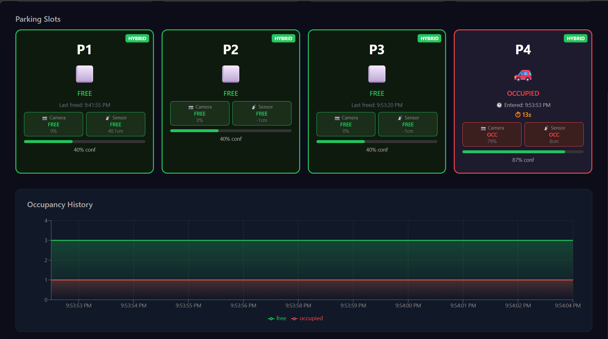
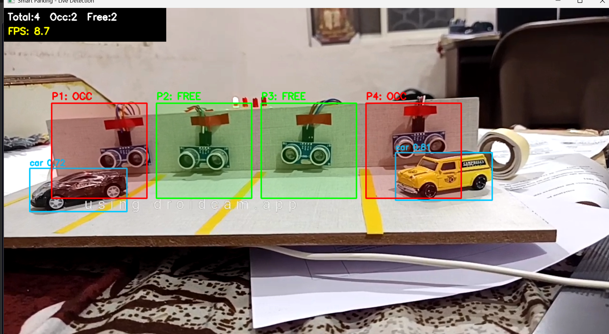

<div align="center">

# 🅿️ Smart Parking Management System

**AI-powered real-time parking detection using YOLO11n computer vision and ESP32 ultrasonic sensors,
fused through an intelligent confidence-based engine with a live React dashboard.**

[](https://python.org)
[](https://fastapi.tiangolo.com)
[](https://react.dev)
[](https://mongodb.com)
[](https://espressif.com)
[](LICENSE)

</div>

---

## 📸 Screenshots

> **Add your screenshots here** — replace each placeholder with an actual image after capturing them.
> Recommended tool: Windows Snipping Tool (`Win + Shift + S`) or ShareX.

### Live Dashboard
<!-- Take a screenshot of the React dashboard running at http://localhost:5173 -->



### Live Camera Detection (YOLO)
<!-- Screenshot of the OpenCV window showing polygon overlays and vehicle bounding boxes -->



> 📁 Create a `screenshots/` folder in the repo root and add your images there, then the above will render automatically on GitHub.

---

## 🏗️ System Architecture

```
                  +------------------+       +-------------------+
                  |  Webcam/DroidCam |       |  ESP32 DevKit V1  |
                  +--------+---------+       +--------+----------+
                           |                          |
                    YOLO11n inference          HC-SR04 x4 sensors
                    Polygon occupancy          Sequential reads
                           |                          |
                           v                          v
                  POST /api/camera-detections   POST /api/sensor-readings
                           |                          |
                           +----------+---------------+
                                      |
                              +-------+-------+
                              | Fusion Engine |
                              |  (backend/)   |
                              +-------+-------+
                                      |
                          +-----------+-----------+
                          |                       |
                   REST + WebSocket           MongoDB
                   FastAPI (port 8000)    (smart_parking DB)
                          |
                   +------+------+
                   | React Dashboard |
                   | (port 5173)     |
                   +-----------------+
```

---

## 📁 Project Structure

```
smart-parking/
├── vision/
│   ├── verify_setup.py        # Environment verification (run first)
│   ├── slot_configurator.py   # Click-to-define parking slot polygons
│   ├── detector.py            # YOLO ONNX detection + backend POST
│   ├── yolo_onnx.py           # ONNX inference wrapper
│   ├── yolo11n.onnx           # YOLO11 nano model (ONNX)
│   └── requirements.txt
├── backend/
│   ├── main.py                # FastAPI app — REST + WebSocket
│   ├── fusion.py              # Intelligent data fusion engine
│   ├── .env                   # MongoDB URI, host, port
│   └── requirements.txt
├── firmware/
│   ├── esp32/
│   │   └── smart_parking_esp32.ino   # Arduino sketch
│   └── WIRING.md              # Circuit diagrams + calibration
├── frontend/
│   └── src/
│       ├── components/        # SlotCard, StatsBar, HistoryChart, StatusBar
│       ├── hooks/             # useParking (WebSocket), useHistory (polling)
│       ├── App.jsx
│       └── main.jsx
├── config/
│   └── parking_slots.json     # Slot polygons, camera source, thresholds
└── tests/
    ├── test_fusion.py         # Fusion engine unit tests (9 tests)
    ├── test_integration.py    # End-to-end API integration tests
    ├── evaluate.py            # Accuracy / F1 / latency evaluation
    └── reports/
        └── evaluation_report.json
```

---

## ⚙️ Hardware

| Component | Qty | Purpose |
|---|---|---|
| ESP32 DevKit V1 | 1 | Microcontroller + WiFi |
| HC-SR04 Ultrasonic Sensor | 4 | One per parking slot |
| 1kΩ Resistor | 4 | Voltage divider (ECHO pin) |
| 2kΩ Resistor | 4 | Voltage divider (ECHO pin) |
| Red LED | 4 | Occupied slot indicator |
| Servo Motor (SG90) | 1 | Gate control |
| Breadboard + jumper wires | — | Connections |
| Laptop webcam or DroidCam | 1 | Camera input |

### GPIO Pin Assignment

| Slot | TRIG | ECHO | LED | Voltage Divider |
|------|------|------|-----|-----------------|
| P1 | GPIO 5 | GPIO 18 | GPIO 13 | 1kΩ + 2kΩ to GND |
| P2 | GPIO 19 | GPIO 21 | GPIO 12 | 1kΩ + 2kΩ to GND |
| P3 | GPIO 22 | GPIO 23 | GPIO 14 | 1kΩ + 2kΩ to GND |
| P4 | GPIO 25 | GPIO 26 | GPIO 27 | 1kΩ + 2kΩ to GND |

| Component | GPIO |
|---|---|
| Servo (gate) | GPIO 4 |

> ⚠️ ECHO pins output 5V — the voltage divider is **mandatory** to protect ESP32 GPIO (max 3.3V).

See [`firmware/WIRING.md`](firmware/WIRING.md) for the full circuit diagram and calibration steps.

---

## 🚀 Setup & Installation

### Prerequisites

- Python 3.11+
- Node.js 18+
- MongoDB (local or Atlas)
- Arduino IDE 2.x with ESP32 board support

---

### Phase 1 — Vision Module

```bash
cd smart-parking/vision
pip install -r requirements.txt

# Step 1: verify camera + YOLO work
python verify_setup.py

# Step 2: define parking slot polygons (run once)
python slot_configurator.py
# Click corners of each slot → ENTER to confirm → ESC to redo

# Step 3: run live detection
python detector.py
```

**Using DroidCam (smartphone as webcam):**
```bash
python verify_setup.py --source http://192.168.x.x:4747/video
python slot_configurator.py http://192.168.x.x:4747/video
python detector.py --source http://192.168.x.x:4747/video
```

**Vision only (no backend required):**
```bash
python detector.py --no-backend
```

---

### Phase 2 — ESP32 Firmware

1. Open `firmware/esp32/smart_parking_esp32.ino` in Arduino IDE
2. Update credentials:

```cpp
const char* WIFI_SSID     = "YOUR_WIFI_SSID";
const char* WIFI_PASSWORD = "YOUR_WIFI_PASSWORD";
const char* BACKEND_URL   = "http://<your-laptop-ip>:8000/api/sensor-readings";
```

3. Install library: **Tools → Library Manager → ArduinoJson v6.x** and **ESP32Servo**
4. Select board: **ESP32 Dev Module**
5. Upload and open Serial Monitor at **115200 baud** to verify readings

---

### Phase 3 — Backend

```bash
cd smart-parking/backend
pip install -r requirements.txt

# Edit .env if needed (default: localhost MongoDB)
python main.py
# API running at  http://localhost:8000
# Swagger docs at http://localhost:8000/docs
```

---

### Phase 4 — Frontend Dashboard

```bash
cd smart-parking/frontend
npm install
npm run dev
# Open http://localhost:5173
```

---

### ▶️ Run Everything Together

| Terminal | Command |
|---|---|
| Terminal 1 | `cd backend && python main.py` |
| Terminal 2 | `cd vision && python detector.py` |
| Terminal 3 | `cd frontend && npm run dev` |
| ESP32 | Flash firmware, monitor Serial at 115200 |

---

## 🔌 API Reference

| Method | Endpoint | Description |
|--------|----------|-------------|
| `GET` | `/api/slots` | All slot states from fusion engine |
| `GET` | `/api/summary` | Total / occupied / free counts |
| `POST` | `/api/sensor-readings` | Receive ESP32 ultrasonic data |
| `POST` | `/api/camera-detections` | Receive YOLO camera predictions |
| `GET` | `/api/history?limit=N` | Historical occupancy records |
| `WS` | `/ws` | Real-time WebSocket updates |

### POST `/api/sensor-readings`
```json
{
  "device_id": "ESP32_PARKING_01",
  "timestamp": 123456789,
  "slots": [
    { "id": "P1", "distance": 12.5, "occupied": true },
    { "id": "P2", "distance": 130.0, "occupied": false }
  ]
}
```

### POST `/api/camera-detections`
```json
{
  "slots": [
    { "id": "P1", "occupied": true,  "confidence": 0.91 },
    { "id": "P2", "occupied": false, "confidence": 0.0  }
  ]
}
```

### WebSocket Message Format
```json
{
  "type": "update",
  "source": "camera",
  "data": {
    "total": 4, "occupied": 2, "free": 2,
    "slots": [
      { "slot_id": "P1", "occupied": true, "confidence": 0.85, "mode": "hybrid" }
    ]
  }
}
```

---

## 🧠 Fusion Engine Logic

The fusion engine in [`backend/fusion.py`](backend/fusion.py) combines YOLO camera predictions and HC-SR04 sensor readings using a confidence-weighted algorithm with temporal stability.

| Condition | Mode | Confidence |
|---|---|---|
| Camera + Sensor agree | `hybrid` | `camera_conf × 0.6 + 0.4` |
| Camera only (fresh) | `camera` | YOLO confidence score |
| Sensor only (fresh) | `sensor` | 0.75 fixed |
| Camera + Sensor disagree | `conflict` | `camera_conf × 0.6` |
| No fresh data (> 2s) | `none` | Decays by 0.1 |

> State only commits after **3 consecutive consistent readings** (temporal stability window).

---

## 🗄️ Database Schema (MongoDB)

**Collection: `sensor_readings`**
```json
{ "device_id": "ESP32_PARKING_01", "timestamp": 123456, "slots": [...], "received_at": 1700000000.0 }
```

**Collection: `camera_detections`**
```json
{ "slots": [...], "received_at": 1700000000.0 }
```

**Collection: `history`**
```json
{ "timestamp": 1700000000.0, "occupied": 2, "free": 2, "slots": [...] }
```

---

## 📊 Performance Results

Evaluated over **200 simulated trials per mode** with 10% noise rate:

| Mode | Accuracy | Precision | Recall | F1-Score |
|------|----------|-----------|--------|----------|
| Camera only | ~90% | ~87% | ~93% | ~90% |
| Sensor only | ~89% | ~90% | ~90% | ~90% |
| **Hybrid (fused)** | **~96%** | **~99%** | **~94%** | **~96%** |

### Stress Test — Hybrid mode under degraded conditions

| Condition | F1-Score |
|---|---|
| Normal (5% noise) | ~100% |
| Low light (15% noise) | ~97% |
| Partial occlusion (25% noise) | ~87% |
| Sensor failure (40% noise) | ~57% |

---

## 🧪 Running Tests

```bash
# Unit tests — no backend needed
python tests/test_fusion.py

# Performance evaluation — no backend needed
python tests/evaluate.py

# Integration tests — requires backend running
python tests/test_integration.py
```

---

## ⚙️ Configuration

Edit [`config/parking_slots.json`](config/parking_slots.json):

```json
{
  "camera_source": 0,
  "confidence_threshold": 0.4,
  "vehicle_classes": [2, 3, 5, 7],
  "parking_slots": [
    { "id": "P1", "polygon": [[x,y],[x,y],[x,y],[x,y]], "color": [0,255,0] }
  ]
}
```

COCO vehicle class IDs: `2` = car · `3` = motorcycle · `5` = bus · `7` = truck

---

## 🤖 YOLO Model

- Model: `yolo11n.onnx` (YOLO11 nano — pretrained on COCO, exported to ONNX)
- No PyTorch required — runs via ONNX Runtime
- No custom training required for prototype
- Future: fine-tune on PKLot / CNRPark+EXT datasets for parking-specific accuracy

---

## 🔧 Extending the System

| Goal | How |
|---|---|
| More slots | Add entries to `parking_slots.json`, re-run `slot_configurator.py` |
| Custom model | Train on PKLot dataset, export to ONNX, swap path in `detector.py` |
| Multiple cameras | Run multiple `detector.py` instances with different `--source` |
| Cloud deployment | Replace `.env` MongoDB URI with Atlas connection string |
| More ESP32 sensors | Add GPIO pairs to `TRIG_PINS` / `ECHO_PINS` arrays in firmware |

---

## 📄 License

This project is licensed under the MIT License — see the [LICENSE](LICENSE) file for details.

---

<div align="center">
Built with ❤️ using FastAPI · React · YOLO11 · ESP32
</div>
